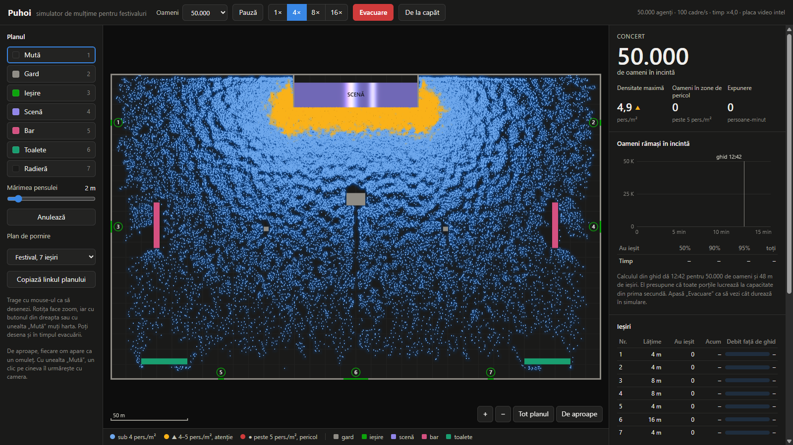

# Puhoi

Desenezi planul unui festival și simulezi până la 100.000 de oameni, fiecare în parte: unde se formează îmbulzeala, pe ce porți ies și cât durează evacuarea. Simularea rulează pe placa video, direct în browser.


## De ce există

Calculul obișnuit pentru evacuare e o împărțire: câți oameni sunt, câți metri de porți ai, câți oameni trec pe minut printr-un metru de poartă. El presupune că toate porțile lucrează la capacitate din prima secundă. În realitate oamenii merg spre ieșirea cea mai apropiată, așa că unele porți se sufocă, iar altele stau aproape goale.

Pe planul implicit, cu 50.000 de oameni și 48 m de porți, calculul din ghid dă **12:42**. Simularea, cu ipotezele implicite, dă **33:07**, fiindcă 44% din public iese pe cele două porți de lângă scenă, care au împreună doar 8 m.

## Ce face

- **Simulează fiecare om.** Fiecare are viteza și lățimea lui, ocolește gardurile, păstrează distanța față de cel din față și încetinește când se aglomerează.
- **Te lasă să desenezi planul.** Garduri, ieșiri, scenă, baruri și toalete, cu mouse-ul, inclusiv în timpul evacuării. Dacă închizi o poartă, mulțimea își schimbă drumul pe loc.
- **Arată unde e periculos.** Harta se colorează după densitate: galben între 4 și 5 persoane/m², roșu peste 5. Poți vedea și zonele de risc, adică maximul atins în fiecare loc pe toată durata evacuării.
- **Măsoară evacuarea:**
  - timpul în care au ieșit 50%, 90%, 95% și toți oamenii;
  - câți au ieșit pe fiecare poartă și debitul ei față de valoarea din ghid;
  - expunerea: câte persoane-minut s-au petrecut la peste 5 persoane/m².
- **Compară rulările.** Schimbi planul, apeși din nou „Evacuare” și vezi diferența față de rularea dinainte.
- **Simulează și concertul.** Înainte de evacuare, publicul stă în fața scenei, iar o parte merge la bar sau la toaletă și se întoarce.
- **Are două ipoteze pe care le poți schimba:** câți oameni știu ce ieșiri sunt libere (de la stewarzi sau de pe ecrane) și cât durează până încep să se miște.
- **Păstrează planul într-un link**, pe care îl poți trimite altcuiva.
- **Se vede și de aproape.** Când faci zoom, fiecare om apare ca un omuleț văzut de sus, care pășește și se uită încotro merge. Cu unealta „Mută”, un clic pe cineva îl urmărește cu camera.

| De aproape, într-o coadă la ieșire | Concertul, înainte de evacuare |
| --- | --- |
|  |  |

## Un exemplu

Am lărgit cele două ieșiri de lângă scenă de la 4 m la 12 m și am rulat din nou aceeași evacuare: 50.000 de oameni, jumătate dintre ei știu ce ieșiri sunt libere, timp de reacție de cel mult 20 de secunde.

| | Plan implicit | Ieșirile de lângă scenă lărgite |
| --- | --- | --- |
| Lățimea totală a porților | 48 m | 64 m |
| Calculul din ghid | 12:42 | 9:32 |
| 95% afară, în simulare | 28:13 | 12:52 |
| Toți afară, în simulare | 33:07 | 16:14 |
| Expunere la peste 5 persoane/m² | 107.002 persoane-minut | 5.633 persoane-minut |

Cu o treime mai mulți metri de poartă, evacuarea durează la jumătate, iar expunerea scade de 19 ori. Calculul din ghid nu poate arăta asta, fiindcă nu știe unde sunt porțile.

## Ce am măsurat

Toate cifrele de mai jos sunt măsurate pe 25 noiembrie 2026, pe un laptop cu NVIDIA GeForce GTX 1650, în Chrome. Le poți reface cu `node test/validate.mjs`.

**Viteza de mers la densitate fixă**, într-un coridor de 60 × 10 m, față de relația lui Weidmann:

| Densitate (pers./m²) | 0,5 | 1 | 1,5 | 2 | 2,5 | 3 | 4 | 5 |
| --- | --- | --- | --- | --- | --- | --- | --- | --- |
| Simulare (m/s) | 1,20 | 0,96 | 0,73 | 0,56 | 0,42 | 0,32 | 0,15 | 0,03 |
| Weidmann (m/s) | 1,30 | 1,06 | 0,81 | 0,61 | 0,45 | 0,33 | 0,16 | 0,04 |

Simularea iese cu cel mult 0,10 m/s sub Weidmann, fiindcă cei rapizi rămân în spatele celor lenți.

**Debitul printr-o poartă**, cu 2.800 de oameni într-un țarc de 40 × 30 m:

| Lățimea porții | 2 m | 4 m | 6 m | 8 m | 12 m |
| --- | --- | --- | --- | --- | --- |
| Persoane pe minut, pe metru | 80 | 89 | 84 | 80 | 76 |

Ghidul britanic pentru stadioane (Green Guide) socotește 82.

**Placa video față de procesor.** Aceeași evacuare, cu 10.000 de oameni, rulată cu cele două implementări:

| | 50% afară | 90% afară | 95% afară | Toți afară |
| --- | --- | --- | --- | --- |
| Placa video (WebGPU) | 2:19 | 7:50 | 8:44 | 9:46 |
| Procesor (JavaScript) | 2:19 | 7:50 | 8:44 | 9:44 |

**Viteza de calcul**, pentru un pas de simulare (0,05 secunde simulate):

| Oameni | Placa video | Procesor |
| --- | --- | --- |
| 10.000 | – | 12,1 ms |
| 50.000 | 0,40 ms în concert, 0,47 ms în evacuare | – |
| 100.000 | 0,69 ms în concert, 0,89 ms în evacuare | – |

Cu 50.000 de oameni, placa video ar putea simula de aproximativ 100 de ori mai repede decât timpul real. Interfața merge până la 16×.

## Cum funcționează

Nu are server și nici pas de build: sunt module JavaScript încărcate direct de browser.

| Parte | Cum |
| --- | --- |
| Drumul spre ieșire | Pentru fiecare țintă (scenă, bar, toalete, ieșiri) se calculează un câmp de direcții cu metoda fast marching, așa că drumurile pot merge în orice unghi, nu doar pe cele 8 direcții ale grilei |
| Alegerea ieșirii | Două câmpuri: cea mai apropiată ieșire și cea mai rapidă ieșire ținând cont de aglomerația de acum. Al doilea se recalculează de două ori pe secundă, într-un web worker |
| Viteza de mers | Relația viteză–densitate a lui Weidmann, aplicată densității medii pe circa 9 m², citită puțin în fața omului |
| Vecinii | Oamenii sunt sortați în celule de 1 m cu contoare atomice, pe placa video. Fiecare se uită doar în cele 9 celule din jur: păstrează distanța, nu intră în cel din față și ocolește la dreapta pe cine vine din față |
| Gardurile | Coliziune exactă cerc–pătrat cu celulele pline din jur |
| Harta de densitate | Calculată tot pe placa video, la fiecare pas, împreună cu maximul atins și timpul petrecut peste prag |
| Desenarea | Aceeași memorie de pe placa video e citită direct de shaderul de desenare, fără să treacă prin procesor. Pozițiile se interpolează între ultimii doi pași, ca mișcarea să fie lină la orice viteză |
| Rezerva | Aceeași simulare scrisă în JavaScript, pentru browserele fără WebGPU (cel mult 10.000 de oameni) și pentru testele din Node |

Un pas de simulare are trei treceri de calcul pe placa video: sortarea în celule, mișcarea oamenilor și harta de densitate.

## Cum îl pornești

Ai nevoie de Chrome sau Edge, care au WebGPU. Servește folderul și deschide pagina:

```sh
python -m http.server 8000
```

Apoi intră pe http://localhost:8000. Deschis direct din fișier nu merge, fiindcă browserul nu încarcă module de pe `file://`.

- **Spațiu:** pauză. **E:** evacuare. **R:** de la capăt. **1–7:** uneltele. **Ctrl+Z:** anulează.
- **Rotița sau + și −:** zoom. **0:** tot planul. **C:** de aproape, în locul cel mai aglomerat. **Butonul din dreapta:** muți harta.

Testele de calibrare:

```sh
node test/validate.mjs            # toate
node test/validate.mjs gate       # doar debitul prin porți
node test/validate.mjs evac 10000 0   # evacuarea planului implicit, 10.000 de oameni, 0% ghidare
```

## Fișierele

| Fișier | Ce conține |
| --- | --- |
| `src/model.js` | Constantele modelului, planurile de pornire, așezarea mulțimii |
| `src/field.js` | Câmpurile de direcții (fast marching) |
| `src/sim-gpu.js` | Simularea și desenarea în WebGPU (shadere WGSL) |
| `src/sim-cpu.js` | Aceeași simulare în JavaScript |
| `src/render2d.js` | Desenarea pe Canvas, pentru varianta pe procesor |
| `src/worker.js` | Calculul câmpurilor în afara firului principal |
| `src/main.js` | Interfața: editorul, controalele, panoul cu rezultate |
| `test/validate.mjs` | Măsurătorile din secțiunea de mai sus |

## Limitări

- **Nu e un instrument certificat.** Arată diferențe între planuri, dar nu înlocuiește planul de evacuare făcut de un specialist.
- **Oamenii sunt cuminți.** Nu există panică, căzături, grupuri care vor să rămână împreună sau oameni care se întorc după cineva.
- **Terenul e plat**, fără scări, pante sau noroi, iar dincolo de poartă e loc liber: oamenii dispar imediat ce au ieșit.
- **Grila e de 1 m.** Gardurile au cel puțin 1 m grosime, iar porțile au lățimi în metri întregi.
- **Densitatea e o medie pe circa 9 m².** În cozi, vârfurile ajung până la 5,9 persoane/m², peste limita de 5,4 la care modelul oprește mersul, fiindcă trupurile se pot suprapune puțin.
- **Câți oameni știu ce ieșiri sunt libere e o ipoteză**, nu o măsurătoare. Rezultatul depinde mult de ea: aceeași evacuare cu 10.000 de oameni durează 9:44 cu 0% și 4:37 cu 100%.
- **Pe ecran n-am măsurat cadrele pe secundă.** În testul automat, fără fereastră, pagina a desenat 100 de cadre pe secundă cu 50.000 de oameni la viteza 16×.

## Surse

- U. Weidmann, *Transporttechnik der Fussgänger*, ETH Zürich, 1993: relația viteză–densitate.
- *Guide to Safety at Sports Grounds* (Green Guide): 82 de persoane pe minut pe metru de ieșire, pe teren plat.
- J. A. Sethian, 1996: metoda fast marching.
