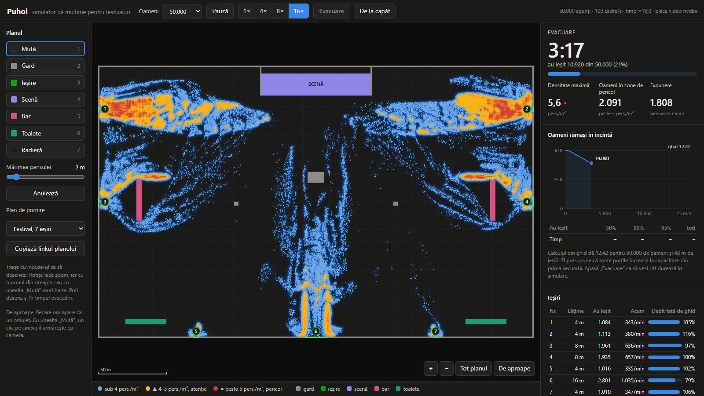
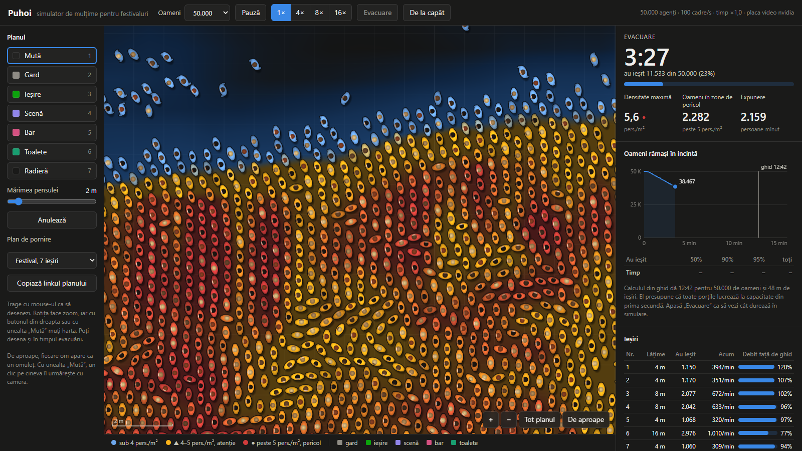

# Puhoi

**Simulator de evacuare pentru festivaluri, pe placa video, direct în browser.** Desenezi planul unui festival, pui până la 150.000 de oameni, fiecare simulat separat, și vezi unde se formează îmbulzeala, pe ce porți iese lumea și cât durează evacuarea.

**Demo live:** https://marioalbu08.github.io/puhoi/ (Chrome sau Edge, pe calculator)

WebGPU · fără dependențe · fără build · 165 KB de cod (51 KB comprimat) · 120.000 de oameni la 60 de cadre pe secundă pe un laptop de gaming obișnuit



## Demo în 60 de secunde

1. Deschide [demo-ul](https://marioalbu08.github.io/puhoi/) în Chrome sau Edge.
2. La „Plan de pornire”, alege **Beach, Please! 2026 (aproximativ, doar porțile publice)**.
3. Apasă **C**. Camera zboară în cea mai deasă mulțime, iar cei din fața scenei sar pe ritm.
4. Apasă **E**. Pornește evacuarea: graficul și tabelul cu porți se completează în timp real.
5. Alege **Beach, Please! 2026 + ieșiri de urgență ipotetice**, apasă **E** din nou și compară cele două rulări în tabelul „Rulări”.
6. Pentru ieșirea obișnuită de la final, fără evacuare, alege **Beach, Please! 2026, ieșire la final** și apasă **I**. Se folosesc doar cele două porți publice, din nord-vest (stânga sus) și sud-est (dreapta jos), iar oamenii pleacă treptat, în primele 15 minute.

| De aproape, într-o coadă la ieșire | Concertul, înainte de evacuare |
| --- | --- |
|  |  |

## Problema

Calculul obișnuit pentru evacuare e o împărțire: câți oameni sunt, câți metri de porți ai, câți oameni trec pe minut printr-un metru de poartă. Calculul presupune că toate porțile lucrează la capacitate din prima secundă. În realitate, oamenii merg spre ieșirea cea mai apropiată, așa că unele porți se sufocă, iar altele stau aproape goale.

Pe planul implicit, cu 7 porți care au în total 48 m, și 50.000 de oameni, calculul din ghid dă **12:42**. Simularea dă **23:27**, cu ipotezele implicite: jumătate dintre oameni știu ce ieșiri sunt libere, iar fiecare pornește după cel mult 20 de secunde. Cele două porți de câte 4 m de lângă scenă au preluat 16.053 de oameni, adică 32% din public, prin 8 din cei 48 de metri.

Am lărgit apoi cele două porți de lângă scenă de la 4 m la 12 m și am rulat din nou aceeași evacuare:

| | Plan implicit | Porțile de lângă scenă lărgite |
| --- | --- | --- |
| Lățimea totală a porților | 48 m | 64 m |
| Calculul din ghid | 12:42 | 9:31 |
| 50% afară | 6:48 | 5:26 |
| 90% afară | 15:43 | 10:10 |
| 95% afară | 19:19 | 11:15 |
| Toți afară | 23:27 | 12:47 |
| Densitatea maximă | 5,9 pers./m² | 5,7 pers./m² |
| Expunere la peste 5 pers./m² | 22.167 persoane-minut | 548 persoane-minut |

Cu o treime mai mulți metri de poartă, evacuarea se scurtează cu 46%, iar expunerea scade de 40 de ori. Calculul din ghid nu poate arăta asta, fiindcă nu știe unde sunt porțile.

## Studiu de caz: Beach, Please! 2026

Beach, Please! 2026 a avut loc între 8 și 12 iulie, în stațiunea NIBIRU din Costinești, pe aproximativ 21 de hectare. În a doua seară au intrat peste 120.000 de oameni, iar vârful festivalului a fost de circa 155.000 pe zi. Harta oficială arată patru scene și **două porți publice**, la aproape 650 m una de alta: una în nord-vest, dinspre parcare, peste calea ferată, și una în sud-est, spre faleză.

Planul de evacuare al festivalului nu este public. Nici organizatorii, nici ISU Dobrogea nu au publicat numărul sau lățimea ieșirilor de urgență și nici punctele de adunare. De aceea, simularea nu spune cât durează evacuarea reală. Ea arată cât ar dura cu ipotezele de mai jos și cât contează fiecare metru de poartă.

Am refăcut planul la scară, 520 × 400 m, cu o celulă pe metru, după harta oficială 2026:

| Ce | De unde |
| --- | --- |
| Mărimea terenului, cele patru scene și orientarea lor | harta oficială (scena principală e în sud-vest, cu fața spre nord) |
| Cele două porți publice și pozițiile lor | harta oficială |
| 120.000 de oameni | a doua seară din 2026 |
| Lățimea porților: 24 m fiecare | **presupusă**, fiindcă nu e publicată |
| Cele 6 ieșiri de urgență de câte 10 m din a doua variantă | **inventate**, ca să se vadă efectul |
| Pozițiile barurilor, toaletelor și clădirilor | **aproximative**, fiindcă harta oficială e schematică |

Marea nu este o cale de evacuare: terenul nu ajunge la plajă, iar între festival și apă sunt o stradă și faleza.

Rezultatele, cu 120.000 de oameni și ipotezele implicite (jumătate știu ce ieșiri sunt libere, reacție în cel mult 20 de secunde):

| | Doar porțile publice | + ieșiri de urgență ipotetice |
| --- | --- | --- |
| Porți | 2 × 24 m = 48 m | 48 m + 6 × 10 m = 108 m |
| Calculul din ghid | 30:29 | 13:33 |
| 50% afară | 21:46 | 10:54 |
| 90% afară | 40:57 | 36:01 |
| 95% afară | 44:57 | 48:14 |
| Toți afară | 49:30 | 62:00 |
| Densitatea maximă | 5,8 pers./m² | 6,1 pers./m² |
| Expunere la peste 5 pers./m² | 39.830 persoane-minut | 268.753 persoane-minut |

**Doar cu porțile publice**, evacuarea durează cu 19 minute mai mult decât spune ghidul. Porțile sunt la 650 m una de alta, iar publicul de la scena principală, din colțul de sud-vest, trebuie să traverseze tot terenul. Poarta de sud-est preia 73.969 de oameni (62%), iar cea de nord-vest 46.031.

**Cu încă 60 m de ieșiri**, prima jumătate a publicului iese de două ori mai repede, dar ultimii oameni ies mai târziu (62:00 față de 49:30), iar expunerea e de 7 ori mai mare. Explicația e în numărătoarea pe ieșiri: ieșirea de 10 m din sud, dintre scena principală și Nibiru Arena, a strâns 29.397 de oameni, iar una de pe latura de est 19.249. Cine nu știe ce ieșiri sunt libere merge la cea mai apropiată și rămâne la ea. Prin 10 m, 29.397 de oameni au nevoie de cel puțin 36 de minute, chiar la debitul maxim din ghid.

Concluzia: mai multe ieșiri nu ajută automat. Contează unde sunt și cât de late sunt față de mulțimea din jurul lor, iar asta se vede doar dacă simulezi fiecare om. În aplicație poți lărgi chiar tu ieșirile cele mai aglomerate și poți compara rulările.

## Ce face

- **Simulează fiecare om.** Fiecare are viteza și lățimea lui, ocolește gardurile, păstrează distanța față de cel din față și încetinește când se aglomerează.
- **Te lasă să desenezi planul.** Garduri, ieșiri, scenă, baruri și toalete, cu mouse-ul, inclusiv în timpul evacuării. Dacă închizi o poartă, mulțimea își schimbă drumul pe loc.
- **Arată unde e periculos.** Harta se colorează după densitate: galben între 4 și 5 persoane/m², roșu peste 5. Poți vedea și zonele de risc, adică maximul atins în fiecare loc pe toată durata evacuării.
- **Măsoară evacuarea:**
  - timpul în care au ieșit 50%, 90%, 95% și toți oamenii;
  - câți au ieșit pe fiecare poartă și debitul ei față de valoarea din ghid;
  - expunerea: câte persoane-minut s-au petrecut la peste 5 persoane/m².
- **Compară rulările.** Schimbi planul, apeși din nou „Evacuare” și vezi diferența față de rularea dinainte.
- **Simulează și concertul.** Înainte de evacuare, publicul stă în fața scenei, iar o parte merge la bar sau la toaletă și se întoarce.
- **Are două ipoteze pe care le poți schimba:** câți oameni știu ce ieșiri sunt libere (de la stewarzi sau de pe ecrane) și cât durează până încep să se miște.
- **Păstrează planul într-un link**, pe care îl poți trimite altcuiva.
- **Se vede și de aproape.** Când faci zoom, fiecare om devine un omuleț văzut de sus, care pășește și se uită încotro merge. Cu unealta „Mută”, un clic pe cineva îl urmărește cu camera și îți arată ce face, cât de repede merge și câtă lume e în jurul lui.

## Cum funcționează

Nu are server și nici pas de build: sunt module JavaScript încărcate direct de browser, plus 3 shadere de calcul și 2 de desenare, în WGSL. Tot calculul se face pe placa video a celui care deschide pagina, așa că găzduirea e doar o pagină statică.

### Simularea

| Parte | Cum |
| --- | --- |
| Pasul | Trei treceri de calcul pe placa video, de 20 de ori pe secundă simulată: oamenii sunt sortați în celule de 1 m cu contoare atomice, apoi fiecare se mișcă, apoi se recalculează harta de densitate |
| Drumul spre țintă | Pentru fiecare țintă (scenă, bar, toalete, ieșiri) se calculează un câmp de direcții cu metoda fast marching, așa că drumurile pot merge în orice unghi, nu doar pe cele 8 direcții ale grilei |
| Alegerea ieșirii | Fiecare loc aparține zonei celei mai apropiate ieșiri. Cine nu știe ce ieșiri sunt libere merge la ieșirea zonei lui și nu o schimbă, dar folosește toată lățimea porții și ocolește blocajele: drumul lui se recalculează de două ori pe secundă, în interiorul zonei, cu locurile aglomerate mai greu de traversat. Cine știe ce ieșiri sunt libere urmează un al doilea câmp, care îl poate trimite la altă ieșire. Ambele câmpuri se calculează într-un web worker, ca să nu blocheze pagina |
| Viteza de mers | Relația viteză–densitate a lui Weidmann, aplicată densității medii pe circa 9 m², citită puțin în fața omului |
| Vecinii | Fiecare se uită doar în cele 9 celule din jur: păstrează distanța, nu intră în cel din față și ocolește la dreapta pe cine vine din față |
| Gardurile | Coliziune exactă cerc–pătrat cu celulele pline din jur |
| Riscul | Pe placa video, la fiecare pas: densitatea, maximul atins și timpul petrecut de fiecare loc peste 5 persoane/m² |
| Rezerva | Aceeași simulare scrisă în JavaScript, pentru browserele fără WebGPU (cel mult 10.000 de oameni) și pentru testele din Node |

### Desenarea

- **Mișcare lină.** Simularea avansează în pași de 0,05 secunde. Fiecare cadru desenează oamenii între ultimii doi pași, citind direct ambele copii ale memoriei de pe placa video, fără să treacă prin procesor.
- **Omuleții.** Fiecare om e un singur dreptunghi, rotit după direcția în care se uită. Forma (umeri, cap, față, brațe, picioare și umbră) e calculată pixel cu pixel din funcții de distanță, cu margini netezite. Pasul vine din faza mersului, ținută în memoria fiecărui om: un ciclu complet la 1,4 m. Cine stă pe loc se uită spre ce așteaptă (scena, barul sau ieșirea), citind același câmp de direcții ca simularea. La concert, cei din fața scenei sar pe 124 de bătăi pe minut, unii cu mâinile sus.
- **Harta.** La fiecare modificare a planului, procesorul calculează un câmp de distanță cu semn (o transformare chamfer în două treceri) și umbrele aruncate: 5 ms pentru planul de 320 × 200 m, 14 ms pentru Beach, Please!. Shaderul citește 4 valori pe pixel și obține din ele margini netede, acoperișuri cu pantă luminate după normală, umbre și texturile: acoperișul scenei cu bandă LED pe ritm, copertina barului peste tejghea, cabinele de toaletă, gardurile, clădirile și săgețile de la ieșiri. De departe, toate trec în culorile din legendă, ca să nu pâlpâie.
- **Plăci video slabe.** Oamenii din afara ecranului ies din calcul înainte de orice altceva. Dreptunghiurile sunt strânse pe figură, așa că se desenează de circa 3 ori mai puțini pixeli. Sub 40 de cadre pe secundă, harta se desenează la rezoluție mai mică, până la jumătate. Dacă placa video rămâne în urmă, simularea încetinește în loc să blocheze pagina.

## Ce am măsurat

Toate cifrele de mai jos se pot reface cu `node test/validate.mjs`.

**Viteza de mers la densitate fixă**, într-un coridor de 60 × 10 m, față de relația lui Weidmann:

| Densitate (pers./m²) | 0,5 | 1 | 1,5 | 2 | 2,5 | 3 | 4 | 5 |
| --- | --- | --- | --- | --- | --- | --- | --- | --- |
| Simulare (m/s) | 1,20 | 0,96 | 0,73 | 0,56 | 0,42 | 0,32 | 0,15 | 0,03 |
| Weidmann (m/s) | 1,30 | 1,06 | 0,81 | 0,61 | 0,45 | 0,33 | 0,16 | 0,04 |

Simularea iese cu cel mult 0,10 m/s sub Weidmann, fiindcă cei rapizi rămân în spatele celor lenți.

**Debitul printr-o poartă**, cu 2.800 de oameni într-un țarc de 40 × 30 m:

| Lățimea porții | 2 m | 4 m | 6 m | 8 m | 12 m |
| --- | --- | --- | --- | --- | --- |
| Persoane pe minut, pe metru | 80 | 89 | 84 | 80 | 76 |

Ghidul britanic pentru stadioane (Green Guide) socotește 82.

**Placa video față de procesor.** Aceeași evacuare a planului implicit, cu 10.000 de oameni, rulată cu cele două implementări:

| | 50% afară | 90% afară | 95% afară | Toți afară |
| --- | --- | --- | --- | --- |
| Placa video, nimeni nu știe ce ieșiri sunt libere | 1:49 | 6:15 | 7:01 | 7:50 |
| Procesor, nimeni nu știe ce ieșiri sunt libere | 1:52 | 6:18 | 7:03 | 7:52 |
| Placa video, jumătate știu | 1:52 | 4:16 | 4:58 | 5:45 |
| Procesor, jumătate știu | 1:51 | 4:09 | 4:53 | 5:40 |

Diferența e de cel mult 3 secunde fără ghidare și de cel mult 7 cu ghidare, fiindcă drumurile care țin cont de aglomerație se recalculează la momente puțin diferite în cele două implementări.

## Cum îl pornești

Ai nevoie de Chrome sau Edge, care au WebGPU. Servește folderul și deschide pagina:

```sh
python -m http.server 8000
```

Apoi intră pe http://localhost:8000. Deschis direct din fișier nu merge, fiindcă browserul nu încarcă module de pe `file://`. Cu `?plan=beach` pornește direct pe planul Beach, Please!.

- **Spațiu:** pauză. **E:** evacuare. **R:** de la capăt. **1–7:** uneltele. **Ctrl+Z:** anulează.
- **Rotița sau + și −:** zoom. **0:** tot planul. **C:** de aproape, în locul cel mai aglomerat. **Butonul din dreapta:** muți harta. **Clic pe un om**, cu unealta „Mută”: îl urmărești. **Esc:** nu-l mai urmărești.

Fără HTTPS sau fără WebGPU, pagina pornește pe procesor, cu cel mult 10.000 de oameni, și spune de ce.

Testele de calibrare:

```sh
node test/validate.mjs                # toate
node test/validate.mjs gate           # doar debitul prin porți
node test/validate.mjs evac 10000 0   # evacuarea planului implicit, 10.000 de oameni, 0% ghidare
```

## Fișierele

| Fișier | Ce conține |
| --- | --- |
| `src/model.js` | Constantele modelului, planurile de pornire (inclusiv Beach, Please!), așezarea mulțimii |
| `src/field.js` | Câmpurile de direcții (fast marching) |
| `src/sim-gpu.js` | Simularea și desenarea în WebGPU (shadere WGSL), câmpul de distanță al hărții |
| `src/sim-cpu.js` | Aceeași simulare în JavaScript |
| `src/render2d.js` | Desenarea pe Canvas, pentru varianta pe procesor |
| `src/worker.js` | Calculul câmpurilor în afara firului principal |
| `src/main.js` | Interfața: editorul, camera, controalele, panoul cu rezultate |
| `test/validate.mjs` | Măsurătorile din secțiunea „Ce am măsurat” |

## Limitări

- **Nu e un instrument certificat.** Arată diferențe între planuri, dar nu înlocuiește planul de evacuare făcut de un specialist.
- **Planul Beach, Please! e aproximativ**, iar lățimile porților și ieșirile de urgență sunt presupuse (vezi studiul de caz).
- **Oamenii sunt cuminți.** Nu există panică, căzături, grupuri care vor să rămână împreună sau oameni care se întorc după cineva.
- **Terenul e plat**, fără scări, pante sau noroi, iar dincolo de poartă e loc liber: oamenii dispar imediat ce au ieșit. Coada de la gară sau de la autobuze nu e simulată.
- **Grila e de 1 m.** Gardurile au cel puțin 1 m grosime, iar porțile au lățimi în metri întregi.
- **Densitatea e o medie pe circa 9 m².** În cozi, vârfurile pot trece puțin de 5,4 persoane/m², limita la care modelul oprește mersul, fiindcă trupurile se pot suprapune puțin.
- **Câți oameni știu ce ieșiri sunt libere e o ipoteză**, nu o măsurătoare, iar rezultatul depinde mult de ea: aceeași evacuare cu 10.000 de oameni durează 7:52 când nimeni nu știe și 5:40 când știe jumătate.
- **Cine nu știe ce ieșiri sunt libere nu renunță niciodată la ieșirea lui**, oricât de lungă ar fi coada. De aici vin cozile lungi de la final din rezultatele de mai sus.
- **Netestat:** Safari, Firefox și telefoanele.
